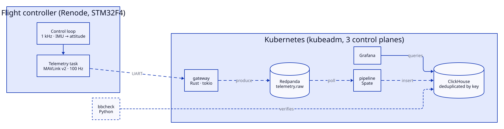
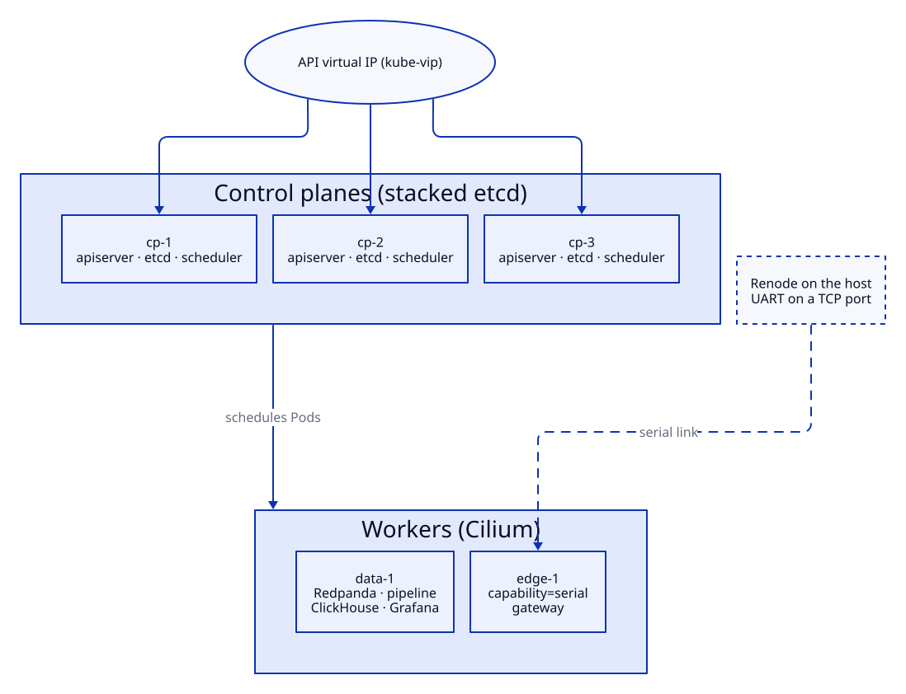

<h1 align="center">
  <picture>
    <source media="(prefers-color-scheme: dark)" srcset="docs/brand/logo-dark.svg">
    
  </picture>
</h1>

<p align="center">
  <a href="https://github.com/guy-with-a-why/telemetry-blackbox/actions/workflows/ci.yml?query=branch%3Amain"></a>
  <a href="https://scorecard.dev/viewer/?uri=github.com/guy-with-a-why/telemetry-blackbox"></a>
  <a href="https://github.com/guy-with-a-why/telemetry-blackbox/actions/workflows/ci.yml?query=branch%3Amain"></a>
</p>

A flight recorder for a simulated flight controller. Rust firmware runs a
1 kHz control loop and streams MAVLink telemetry over a serial link. A Rust
gateway, Redpanda and a [Spate](https://github.com/spate-etl/spate) pipeline
carry every frame into ClickHouse, on a highly available Kubernetes cluster
I built by hand.

> **Status:** under construction, in the open. Progress is tracked in the
> [milestones](../../milestones), and the
> [docs site](https://guy-with-a-why.github.io/telemetry-blackbox/) updates
> with every push.

## Progress

[](https://guy-with-a-why.github.io/telemetry-blackbox/flight-log.html)

[](../../milestone/1) [](../../milestone/2) [](../../milestone/3) [](../../milestone/4) [](../../milestone/5)

The plane moves as issues close. Headwind counts the work that crept in after
takeoff, and a stamp unlocks at each milestone I care most about. The
[flight log](https://guy-with-a-why.github.io/telemetry-blackbox/flight-log.html) has the detail.

## Why I'm building it

I want to understand four things from the bottom up:

- Kubernetes run on my own machines, including the parts that break.
- Rust, both `no_std` on a microcontroller and async on a server.
- Real-time embedded systems and the protocols between them.
- Streaming data into ClickHouse with Spate.

A black box is a good way to learn all four at once. It has a hard deadline
at one end, a database at the other and a simple test in between. Did every
frame arrive?

## The claim

Cut the serial link, kill the pipeline, drain a node or lose a control plane
in the middle of a flight. Every frame still reaches ClickHouse. Some arrive
twice, because delivery is at-least-once, and ClickHouse removes the
duplicates by key. `bbcheck` measures the outcome after each drill, and the
numbers go in [Results](#results).



## How it fits together



Each part has one job.

| Part | Built with | Job |
|---|---|---|
| `firmware/` | Rust, `no_std`, Embassy | Runs the control loop on a hardware timer and sends telemetry over UART |
| `gateway/` | Rust, tokio | Finds frame boundaries, checks CRCs, spots sequence gaps and publishes to Redpanda |
| `pipeline/` | Rust, Spate | Decodes frames, routes them into tables and loads ClickHouse |
| `deploy/` | cloud-init, kubeadm, YAML | Builds the VMs and the cluster, then runs everything on it |
| `tools/bbcheck/` | Python | Proves what arrived: gaps, duplicates and latency |

## The cluster

Five VMs on one machine. Three control planes share a virtual IP, so the API
stays up when one of them goes down. Two workers carry the workloads, and a
node label decides which one owns the serial link.



Renode runs on the host, outside the cluster, because it stands in for a
physical device. On real hardware the gateway would read `/dev/ttyUSB0`.
Here it reads the TCP socket Renode exposes.

## The life of one frame



The last step matters most. Spate only commits an offset once ClickHouse has
confirmed the batch is durable, so a crash can repeat work but never skip it.
That is where duplicates come from, and why the table removes them by
`(boot_id, system_id, seq)`.

## The wire format

Telemetry uses MAVLink v2. Every frame carries a sequence number, which is
what lets the gateway and `bbcheck` count gaps.

| Bytes | Field | Notes |
|---|---|---|
| 1 | `STX` | Always `0xFD` in v2 |
| 1 | `len` | Payload length |
| 1 | `incompat_flags` | Bit 0 marks a signed frame |
| 1 | `compat_flags` | Safe to ignore if unknown |
| 1 | `seq` | Wraps at 255; a jump means lost frames |
| 1 | `sysid` | Which vehicle |
| 1 | `compid` | Which component on it |
| 3 | `msgid` | 24-bit message ID |
| `len` | payload | Trailing zero bytes are trimmed |
| 2 | `checksum` | CRC-16/MCRF4XX, seeded with the message's `CRC_EXTRA` |
| 13 | signature | Only on signed frames |

The firmware sends `HEARTBEAT`, `ATTITUDE`, `HIGHRES_IMU` and a custom
`LOOP_TIMING` message that reports overruns and jitter.

## Real-time, honestly

The control loop is hard real-time inside the simulation. Renode runs in
deterministic virtual time, so loop timing reflects the firmware alone.

Everything after the serial port is soft real-time. I measure it as
end-to-end latency percentiles, from the firmware's timestamp to the row
landing in ClickHouse.

## Running it

Still being built. When it's done, it will look like this:

```bash
mise install    # pinned tools: just, D2, uv, kubectl, Helm and more
just bench      # check everything is installed
just lint       # formatting and lints for the crates, firmware and bbcheck
just test       # the tests, plus a firmware build
just coverage   # line coverage across Rust and Python
just cluster    # five VMs and a highly available cluster
just deploy     # Redpanda, ClickHouse, Grafana, gateway and pipeline
just fly        # boot the firmware in Renode and start streaming
just check      # run bbcheck against ClickHouse
just docs       # build the docs site into book/
just audit      # scan for secrets and blocked terms
```

`just` on its own lists every recipe. You'll also need Linux with KVM, about
10 GB of free memory, [mise](https://mise.jdx.dev), Multipass, Renode, probe-rs,
the ClickHouse client and Rust with the `thumbv7em-none-eabihf` target.

## Repository layout

```text
firmware/        Embassy firmware for the STM32F4
gateway/         serial link to Redpanda
pipeline/        Spate pipeline into ClickHouse
deploy/          VMs, cluster bootstrap and manifests
tools/bbcheck/   delivery and latency report
docs/adr/        decisions and the reasons behind them
docs/brand/      the logo, favicon, social preview and how to use them
docs/diagrams/   D2 sources and the SVGs they render
docs/runbooks/   drills, with real output
scripts/         small checks the justfile and CI call
```

## Decisions

Each gets a short record in `docs/adr/`.

1. MAVLink v2 over a custom framing.
2. kubeadm over k3s or Talos.
3. Redpanda over Apache Iggy or a home-made log.
4. Deduplicating in ClickHouse over chasing exactly-once.
5. just and mise over make, and a local registry for images.

## Results

These fill in as the drills run.

| Drill | Frames sent | Missing | Duplicates | Recovery |
|---|---|---|---|---|
| Kill the pipeline | pending | pending | pending | pending |
| Drain the pipeline's node | pending | pending | pending | pending |
| Restart Redpanda | pending | pending | pending | pending |
| Cut the serial link for 60 s | pending | pending | pending | pending |
| Lose a control plane | pending | pending | pending | pending |
| Scale the pipeline to two replicas | pending | pending | pending | pending |

## Diagrams

Every diagram is a [D2](https://d2lang.com) file in `docs/diagrams/`. D2 lays
it out, and each SVG follows the viewer's light or dark theme. The animated
ones step through boards declared in the same file.

To change one, edit the `.d2` file and watch it live, then render the lot:

```bash
d2 --watch --layout=elk docs/diagrams/architecture.d2
just diagrams
```

## Cite

These are the documents I need to build this, grouped by where I use them.
The board Renode simulates is ST's
[STM32F4DISCOVERY](https://www.st.com/en/evaluation-tools/stm32f4discovery.html),
which is built on the STM32F407VG, a Cortex-M4F.

**Tooling (Day 0)**

- [The just manual](https://just.systems/man/en/) and the [mise documentation](https://mise.jdx.dev/).

**Microcontroller (Day 1)**

- [STM32F407VG datasheet](https://www.st.com/resource/en/datasheet/stm32f407vg.pdf): pinout, memory map and electrical limits.
- [RM0090 reference manual](https://www.st.com/resource/en/reference_manual/rm0090-stm32f405415-stm32f407417-stm32f427437-and-stm32f429439-advanced-armbased-32bit-mcus-stmicroelectronics.pdf): the timers, USART, DMA and clocks, register by register.
- [PM0214 Cortex-M4 programming manual](https://www.st.com/resource/en/programming_manual/pm0214-stm32-cortexm4-mcus-and-mpus-programming-manual-stmicroelectronics.pdf): the NVIC, interrupt priorities, SysTick and the FPU.
- [ES0182 errata](https://www.st.com/resource/en/errata_sheet/es0182-stm32f405407xx-and-stm32f415417xx-device-errata-stmicroelectronics.pdf): known silicon faults. Renode won't reproduce them, but real hardware would.
- [UM1472 Discovery kit user manual](https://www.st.com/resource/en/user_manual/um1472-discovery-kit-with-stm32f407vg-mcu-stmicroelectronics.pdf): the board around the chip.
- [Renode's STM32F4 Discovery platform](https://github.com/renode/renode/blob/master/platforms/boards/stm32f4_discovery-kit.repl) and the [Renode documentation](https://renode.readthedocs.io/en/latest/).
- [The Embassy book](https://embassy.dev/book/) and the [embassy-stm32 API docs](https://docs.embassy.dev/embassy-stm32/).

**Protocol (Days 1 and 3)**

- [MAVLink serialisation](https://mavlink.io/en/guide/serialization.html): the v2 frame byte by byte.
- [MAVLink CRC](https://mavlink.io/en/guide/crc.html): the checksum and `CRC_EXTRA`.
- [MAVLink common messages](https://mavlink.io/en/messages/common.html): `HEARTBEAT`, `ATTITUDE` and `HIGHRES_IMU`.

**Cluster (Day 2)**

- [Multipass documentation](https://canonical.com/multipass/docs).
- [Creating highly available clusters with kubeadm](https://kubernetes.io/docs/setup/production-environment/tools/kubeadm/high-availability/).
- [kube-vip as a static Pod](https://kube-vip.io/docs/installation/static/).
- [Cilium on a kubeadm cluster](https://docs.cilium.io/en/stable/installation/k8s-install-kubeadm/).
- [etcd disaster recovery](https://etcd.io/docs/v3.5/op-guide/recovery/).
- [Upgrading kubeadm clusters](https://kubernetes.io/docs/tasks/administer-cluster/kubeadm/kubeadm-upgrade/).
- [The Distribution registry](https://distribution.github.io/distribution/) and [containerd registry hosts](https://github.com/containerd/containerd/blob/main/docs/hosts.md), for the local image registry.

**Data path (Days 2 and 3)**

- [Redpanda on Kubernetes](https://docs.redpanda.com/current/deploy/redpanda/kubernetes/).
- [ClickHouse ReplacingMergeTree](https://clickhouse.com/docs/engines/table-engines/mergetree-family/replacingmergetree).
- [Spate's connector contracts](https://spate.kainth.dev/docs/user-guide/extending/contracts) and its [delivery invariants](https://github.com/spate-etl/spate/blob/main/docs/INVARIANTS.md).

**Diagrams**

- [A tour of D2](https://d2lang.com/tour/intro/).
