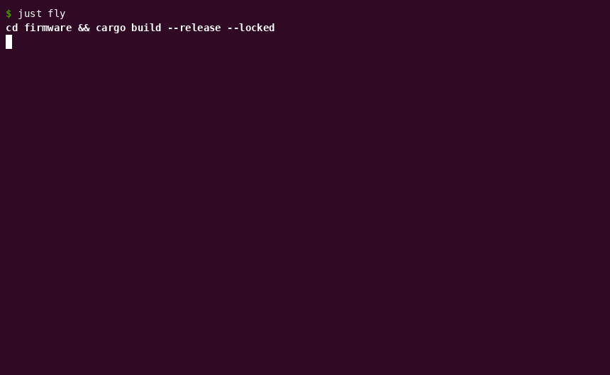

# Ground power: first boot in Renode

*14 November 2026*

## What was done

The firmware boots. It's an Embassy binary for the STM32F407VG, running on the STM32F4DISCOVERY board that Renode simulates, and it blinks the green LED on PD12 every 500 ms. `just fly` builds it, boots the board and shows Renode logging each change of the LED. That closes [#3](https://github.com/guy-with-a-why/telemetry-blackbox/issues/3).

The binary is small: a 392-byte vector table, 3.4 KB of code and 96 bytes of RAM. [`cargo bloat`](https://github.com/RazrFalcon/cargo-bloat) puts 1.5 KB of the code in the main task, where Embassy's chip setup and my blink loop are inlined, and 1.1 KB in the TIM2 timer that wakes it.

## Why was it done that way

I wrote the memory map by hand rather than let Embassy generate it. It's the contract between the linker and the silicon, so I want it in the repo where I can see it. It has two regions from ST's [RM0090 reference manual](https://www.st.com/resource/en/reference_manual/rm0090-stm32f405415-stm32f407417-stm32f427437-and-stm32f429439-advanced-armbased-32bit-mcus-stmicroelectronics.pdf): 1 MiB of flash at `0x0800_0000`, where the core boots, and 128 KiB of SRAM at `0x2000_0000`.

The chip's 64 KiB of core-coupled memory is left out on purpose. CCM is RAM wired straight to the CPU, so the DMA controllers can't reach it. [#6](https://github.com/guy-with-a-why/telemetry-blackbox/issues/6) sends telemetry over the UART by DMA from a static buffer, and if the linker put that buffer in CCM, the transfer would fail while the CPU side looked healthy. Leaving CCM out of the map rules that out, in Renode and on real silicon.

Embassy keeps time on TIM2, chosen explicitly so the other timers stay free for the 1 kHz loop in [#4](https://github.com/guy-with-a-why/telemetry-blackbox/issues/4). The clocks stay on the 16 MHz internal oscillator, which asks the least of Renode's partial clock model. Speed can wait until there's a loop to measure.

## What challenges were faced

Renode was the first wrong turn. The Debian package expects .NET 8 and two other dependencies on the host, and dpkg left it unconfigured. The portable build bundles its own runtime and was already working, so I removed the package.

The rest was reading the binary to check it matched the map. The stack starts at `0x2002_0000`, the top of RAM, and the reset vector at `0x0800_0189` points at [`cortex-m-rt`](https://docs.rs/cortex-m-rt/0.7.7/cortex_m_rt/)'s reset handler with the Thumb bit set. That handler zeroes 72 bytes of `.bss` and copies 24 bytes of `.data` before `main`, and the [Embedonomicon](https://docs.rust-embedded.org/embedonomicon/main.html) explains why. The zeroing matters here. From [#6](https://github.com/guy-with-a-why/telemetry-blackbox/issues/6) the MAVLink sequence counter lives in a static, and if it started at a random value, `bbcheck` would report missing frames that were never sent.

## What's next

The cluster flies next, with four evenings to Friday 20 November. The firmware returns with [#4](https://github.com/guy-with-a-why/telemetry-blackbox/issues/4), which moves the loop onto a hardware timer at 1 kHz.

The biggest firmware risk is the gap between Renode and silicon. The CCM case is one example, and ST's [ES0182 errata sheet](https://www.st.com/resource/en/errata_sheet/es0182-stm32f405407xx-and-stm32f415417xx-device-errata-stmicroelectronics.pdf) lists faults Renode won't reproduce. My fallback is to tie timing claims to Renode's virtual time, where they're deterministic, and mark anything the simulation can't prove as one for real hardware.
