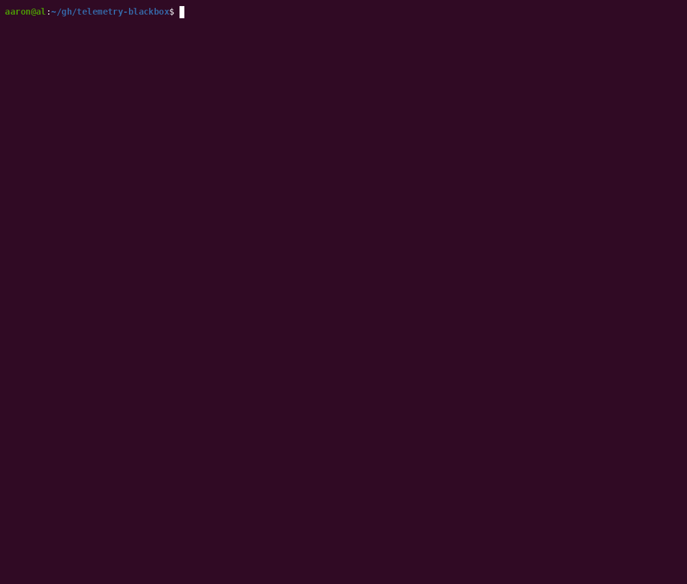
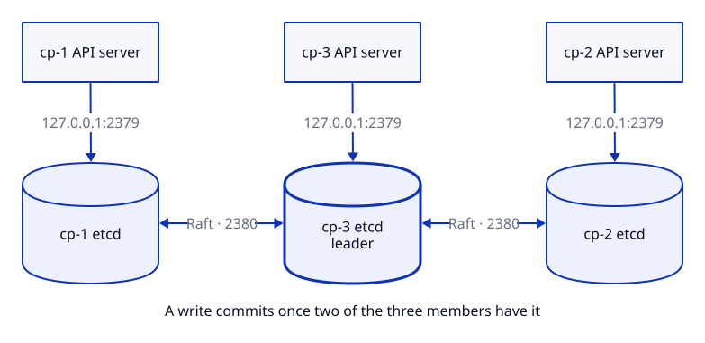

# Engine start: a control plane built by hand

*15 November 2026*

## What was done

I bootstrapped the cluster this afternoon. It's a Sunday, so it came out of the time in hand. I typed every kubeadm command myself on my home server, because that's the point of [#11](https://github.com/guy-with-a-why/telemetry-blackbox/issues/11). Forty-seven minutes after `kubeadm init` on cp-1, `just cluster-check` came back clean. Three control planes answer behind one virtual IP, `10.97.0.250`, two workers have joined and Cilium carries the pod network.

![My home server, an i5-3320M with two cores, four threads and 16 GB, runs five Multipass VMs on QEMU. cp-1, cp-2 and cp-3 each have 2 vCPUs and 1.5 GB, and run static Pods for etcd, the API server, the scheduler, the controller manager and kube-vip, plus the kube-proxy, cilium and cilium-envoy DaemonSets. cp-1 also runs both CoreDNS Pods, and cp-3 holds 10.97.0.250 and the etcd leader. edge-1 has 2 GB and data-1 4 GB, and each runs the DaemonSets and one cilium-operator. Ten vCPUs share four threads on the zone1 bridge.](../diagrams/host-to-pods.svg)

A kubeadm bootstrap goes the way an airliner starts its engines: one at a time, in a fixed order, with the first one on ground power. The cluster even keeps a record of it. Every Pod's age counts from when it started, so reading the `AGE` column oldest first replays the afternoon. cp-1 came up at 12:53, cp-3 joined eight minutes later, then cp-2, then both workers. Cilium went on at the sixteen-minute mark.

This is how things looked a minute or two after that. The control plane was running on all three nodes, but every node was NotReady and CoreDNS was stuck in Pending. That's expected. A node only reports Ready once a network plugin has written its config to `/etc/cni/net.d`, and Cilium writes that file when its agent starts. The agents were still waiting for their images.

The ages show more than the order. `kube-vip-cp-1` is a minute younger than `etcd-cp-1`, which is the one hand edit I made after init. On cp-3, kube-vip is younger than everything else on the node, so it went on after the join, as it should. An hour later, all 34 Pods in `kube-system` were Running. The few restarts are a story for further down.

## Why was it done that way

kube-vip is the first engine, and it needs ground power. It holds the API's virtual IP, so it has to run before the API exists, and it needs credentials to do that. Since Kubernetes 1.29, `admin.conf` has no rights until `kubeadm init` finishes. So on cp-1, kube-vip starts on `super-admin.conf`, which is in the `system:masters` group and skips [RBAC](https://kubernetes.io/docs/reference/access-authn-authz/rbac/#user-facing-roles) entirely. Once init has granted `admin.conf` its rights, I point kube-vip back at it and the cart comes off. The [kube-vip docs](https://kube-vip.io/docs/installation/static/) cover the step.

Forgetting that last step would be easy, and nothing would tell me. kube-vip would carry on working, with rights no RBAC rule can take away. That's why `cluster-check` now looks for it.

Everything in that start sequence runs as a [static Pod](https://kubernetes.io/docs/tasks/configure-pod-container/static-pod/). A Deployment needs the API server to accept it, etcd to store it, the controller manager to create its Pods and the scheduler to place them. Those four are the control plane, so they can't start that way. Instead, the kubelet runs whatever manifests sit in `/etc/kubernetes/manifests`, with no API involved, and keeps them running if the API goes down.

What `kubectl` shows for a static Pod is a reflection the kubelet posts so I can see it. Deleting it changes nothing on the node. I tried it on cp-2. The API server's Pod came straight back with an age of nine seconds, the same container underneath and the node itself, `Node/cp-2`, as its owner. To change a static Pod, I edit its file, which is exactly what switching kube-vip to `admin.conf` was.

kubeadm also wrote the cluster's trust into `/etc/kubernetes/pki`: three certificate authorities, each good for ten years, and certificates that last one. The main one, `ca`, signs for the API server, the other components and both admin kubeconfigs. etcd gets its own authority because it holds everything. Apart from etcd's own members, only the API server and the health check carry a certificate etcd accepts. A leaked kubelet certificate would cost me a node and nothing more. The third authority covers the API server when it hands requests on to extension APIs, and `sa.key` signs the tokens ServiceAccounts carry. The [PKI reference](https://kubernetes.io/docs/setup/best-practices/certificates/) lists every file. Mine expire on 15 November 2027, and `kubeadm upgrade` [renews them](https://kubernetes.io/docs/tasks/administer-cluster/kubeadm/kubeadm-certs/#automatic-certificate-renewal) as it goes, so a cluster upgraded once a year never sees one lapse.

The two admin kubeconfigs differ in one way that matters. `admin.conf` gets its rights from a single ClusterRoleBinding, which I could delete. `super-admin.conf` is in `system:masters`, which no binding grants and none can take away. It lives only on cp-1, readable by root, and nothing runs on it now.

etcd is [stacked](https://kubernetes.io/docs/setup/production-environment/tools/kubeadm/ha-topology/#stacked-etcd-topology), one member on each control plane. External etcd would keep its failures apart from the control plane, but it needs three more VMs on a 16 GB box. Stacked ties each member to its control plane, and [#12](https://github.com/guy-with-a-why/telemetry-blackbox/issues/12) will test what that costs. I went with stacked. Each API server talks only to its own member, on `127.0.0.1:2379`, and the members agree through [Raft](https://raft.github.io/): a write counts once a majority has it.

Three is the smallest cluster that survives a failure, for the same reason fly-by-wire jets vote between three computers. Two that agree outvote one that's wrong. A fourth member adds a vote but no tolerance, because the majority grows to three. Two members are worse than one: either failure stops writes, and there's twice the hardware to fail. The [etcd FAQ](https://etcd.io/docs/v3.6/faq/#why-an-odd-number-of-cluster-members) has the arithmetic. Mine elected cp-3 as leader.

## What challenges were faced

Before the failover drill, I read back through `deploy/` and wasn't sure kube-vip was set up properly. The manifest turned out to be fine. It matches what kube-vip v1.3.1 generates itself, apart from two settings that only matter when the address comes from DHCP or DNS. The issue wasn't fine. [#11](https://github.com/guy-with-a-why/telemetry-blackbox/issues/11) had closed itself when [#84](https://github.com/guy-with-a-why/telemetry-blackbox/pull/84) merged the day before, with every box unticked, and the VMs had been rebuilt that evening without kubeadm ever running. I reopened it. Its boxes are now the only way it closes.

Going through the checks turned up a gap in my own proof. `cluster-check` confirmed one kube-vip held the address and never asked about the other two. A crashlooping standby would have passed, then failed the drill that matters. Nothing checked that cp-1 had come off `super-admin.conf` either. [#100](https://github.com/guy-with-a-why/telemetry-blackbox/pull/100) now fails unless all three run kube-vip on `admin.conf`. It also fixes how I found kube-vip's network interface. I took the third field of `ip route get` for the virtual IP, but on the node holding that IP the answer starts `local 10.97.0.250 dev lo`, and the third field is the word `dev`.

Cilium was slow to start. All five nodes pulled the same images through a quay.io mirror that had never seen them, on a line that tops out near 1 MB/s, and the agents waited over twenty minutes. The mirror pays off on the next rebuild.

The interesting bit came as Cilium finished. My home server was flat out, and a few minutes later its load average read 10 on four threads. cp-1's API server stopped answering in time, and all three leaders on cp-1 lost their [Leases](https://kubernetes.io/docs/concepts/architecture/leases/) within eight seconds: the controller manager, the scheduler and kube-vip. Each one stood down so a standby could take over, which is what they're built to do. cp-3 took the address at 13:36:49, but cp-1 only let go of it twenty seconds later. For those twenty seconds, two nodes answered for the same IP. The cluster carried on, and I'd seen the next drill's failure before I'd started it.

## What's next

[#12](https://github.com/guy-with-a-why/telemetry-blackbox/issues/12) takes the control planes down on purpose, one and then two. With one down, etcd keeps its majority, and if that node held the address, kube-vip should move it within about fifteen seconds. With two down, writes stop. Every kube-vip renews its Lease through its own API server, so I expect the address to vanish, while Pods already on the workers keep serving. [#13](https://github.com/guy-with-a-why/telemetry-blackbox/issues/13) follows with an etcd snapshot and restore.

The biggest risk is CPU. My home server is an i5-3320M from 2012, battery still at 91%, carrying ten vCPUs on four threads. It's earning its keep. At idle, with nothing of mine on it yet, the VMs hold it at about half its CPU, with 575 MiB in swap. Redpanda and ClickHouse will want their share.

If the address moves under ordinary load, I'll lengthen kube-vip's Lease first and measure what that costs the failover. If that isn't enough, the control-plane VMs get a bigger CPU share on the host, so a busy `data-1` can't starve them.

The last box on #11 is mine to tick: explaining static Pods, the PKI and stacked etcd out loud, without notes.

## Quiz

Eight questions on the post, for anyone who wants to check it's landed. Open one for my answer.

You delete <code>kube-apiserver-cp-2</code> with kubectl. What happens on the node?

Nothing. I only deleted the mirror, the kubelet put it straight back and the container never stopped.

Why can't the control plane run as a Deployment?

A Deployment needs the API server, etcd, the scheduler and the controller manager to exist first. Those are the control plane, so the kubelet starts them from files on disk.

Why was every node NotReady until Cilium started?

The kubelet only reports Ready once a network plugin has written its config to `/etc/cni/net.d`. Cilium writes it when its agent starts.

Why does kube-vip start on <code>super-admin.conf</code>, and why move it off?

It has to run before `admin.conf` has any rights. `super-admin.conf` skips RBAC and nothing can revoke it, so it only stays until init finishes.

Why does etcd have its own certificate authority?

So a certificate from the main authority can't open the database. Only the API server and the health check hold one that etcd accepts.

The certificates last a year. What keeps them from expiring?

`kubeadm upgrade` renews them as it goes. Upgrade at least once a year and they never lapse.

Why run three etcd members and not four?

Three survives one failure. Four still only survives one, because the majority grows to three, and there's more hardware to fail.

Two control planes go down. What happens to the virtual IP?

I expect it to vanish. Each kube-vip renews its Lease through its own API server, and without quorum nothing can renew it. #12 will tell me if I'm right.

