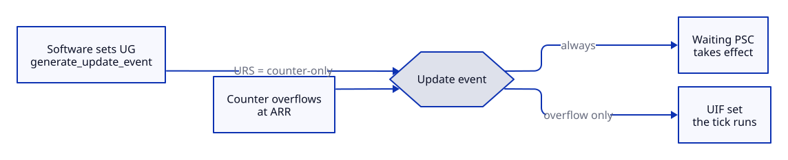
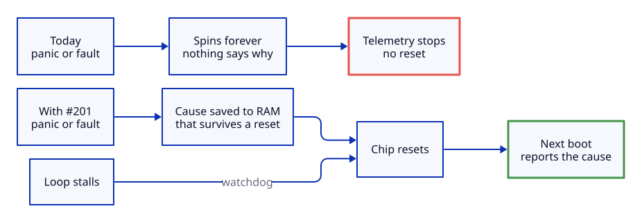
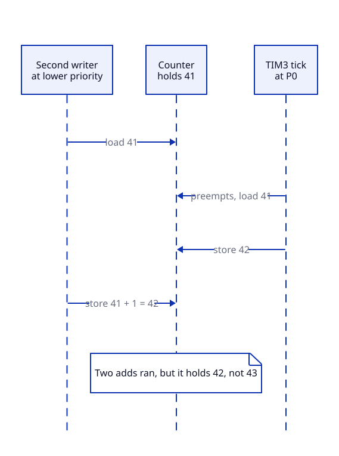

# Walkaround: a defensive review before the firmware grows

*28 November 2026*

## What the review was for

The last drill was meant to break the firmware, and it did. On a throwaway
branch I overflowed the stack, and the loop's timing counters came back
reporting 2,863,311,530 overruns and a worst jitter of 179 seconds. The LED
stopped, and nothing said why. That was
[the stack drill](https://guy-with-a-why.github.io/telemetry-blackbox/blog/2026-11-27-weight-and-balance.html#the-stack-and-the-exception-frame)
in [#198](https://github.com/guy-with-a-why/telemetry-blackbox/pull/198), and
counters that lie without a sound are the one failure a flight recorder can't
afford.

telemetry-blackbox is a flight recorder for a simulated flight controller. Its
firmware is Rust on [Embassy](https://embassy.dev/), for the STM32F407 on ST's
Discovery board, and it runs in the [Renode](https://renode.io/) simulator. The control loop runs in the interrupt of TIM3, a
hardware timer that overflows once a millisecond. That interrupt runs at P0, the
highest priority, and each run of it is a tick.
[#5](https://github.com/guy-with-a-why/telemetry-blackbox/issues/5) is about to
put an attitude estimate, the board's roll, pitch and yaw, in the tick.
[#6](https://github.com/guy-with-a-why/telemetry-blackbox/issues/6) adds a task
beside it that sends the loop's figures to the ground as MAVLink, over a UART
with DMA.

I put #5 on hold and walked round the code first. I was after anything that
could bite later: debt that grows with every copy, code that turns unstable once
more runs beside the loop, weaknesses safe Rust still allows and blind spots in
what the flight recorder can see about itself. #5 already had a plan, and I left
it open to whatever turned up.

The stance is defensive. I assume the next change lands on a weeknight after
work, against Leg 2's due date, and I want the wrong version of it to fail to
compile or fail loudly.

## Why before the code grows

The firmware is as small as it will ever be. Two source files hold 347 lines and
the loop only blinks an LED, so a fix today is an edit to two files. Once #5 and
#6 have copied its patterns, the same fix is a migration or a heavy refactor,
and a fault at P0 is far harder to pin down under load than in a blinking LED.

The bench is also forgiving. Renode executes a flat 100 MIPS, about six times
what this chip manages on its 16 MHz oscillator. A tick that would run past its
deadline on silicon can look fine in simulation. Reading the code doesn't depend
on the bench being honest. I'd rather find the next silent failure on the ground
than in the air.

## How the review worked

I read every file under `firmware/`: the manifest, the build script,
`memory.x`, the Cargo config and both sources. Then I read the dependencies' own
source at the versions `Cargo.lock` pins,
[embassy-stm32 0.6.0](https://docs.rs/crate/embassy-stm32/0.6.0/source/src/timer/low_level.rs)
and [cortex-m-rt 0.7.7](https://docs.rs/crate/cortex-m-rt/0.7.7/source/src/lib.rs).
The docs say what a call is for. Only the source says which register bits it
writes.

My rule was simple. A suspicion only became a finding once the source or the
release build backed it. `llvm-size`, `llvm-nm` and `llvm-objdump` were used to
check the build, and clippy ran over the host tests. A two-line `no_std` crate,
shown under What's next, settled a question about float maths. Each finding was
then ranked by when it bites and by whether it changes the scope of #5.

You can rerun every check here by hand from `firmware/`. The LLVM tools come with
the toolchain's `llvm-tools-preview` component but aren't on my `PATH`, so `bin`
points at them and `elf` at the release build.

```bash
cargo build --release --locked
host=$(rustc -vV | sed -n 's/^host: //p')
bin=$(rustc --print sysroot)/lib/rustlib/$host/bin
elf=target/thumbv7em-none-eabihf/release/firmware
```

## Two suspicions that didn't hold

Both looked solid on paper, and the source cleared both.

### A tick before any overflow

I expected the first tick to fire the moment `main` enabled TIM3's interrupt,
before any real overflow, and to time itself from a moment that never happened.
The reason needs a word on how TIM3 counts.

The timer is fed a 16 MHz clock, and its prescaler register `PSC` divides that
by `PSC + 1` before the counter sees it. The counter then counts up to its
auto-reload value `ARR` and overflows, so one period is `(PSC + 1) × (ARR + 1)`
input clocks. For the loop that's `PSC = 0` and `ARR = 15,999`, so 16,000 counts
of 62.5 ns make one overflow a millisecond.

Each overflow is an update event. It sets TIM3's update flag, `UIF`, and that
flag is what raises the interrupt that runs the tick. Software can force an
update event too, by setting the `UG` bit.

`PSC` is buffered. A new value only takes effect at the next update event, so
`main` calls `generate_update_event` right after setting TIM3's period, to load
it straight away. RM0090, ST's reference manual for the chip, says a software
update event sets `UIF` as well, unless the update request source bit, `URS` in
`TIM3_CR1`, limits the flag to real overflows. embassy-stm32's source says
otherwise:

```rust
pub fn generate_update_event(&self) {
    self.regs_core().cr1().modify(|r| r.set_urs(vals::Urs::COUNTER_ONLY));
    self.regs_core().egr().write(|r| r.set_ug(true));
    self.regs_core().cr1().modify(|r| r.set_urs(vals::Urs::ANY_EVENT));
}
```

It sets `URS` to counter-only, sets `UG` and puts `URS` back. Both kinds of
update event load the new `PSC`, but only an overflow sets the flag while `URS`
is on counter-only:

<a href="../diagrams/tim3-update.svg"></a>

So the first tick waits for a real overflow. That's why I read the source and
not the method's name. `set_tick_freq` in the same file sets `UG` without that
guard, and does set the flag on TIM5, the free-running microsecond clock. It's
harmless only because TIM5's interrupt is never enabled.

### A slow division in the tick

The second was the 64-bit division in `record`, which turns each tick's latency,
how long after the overflow it started, into microseconds. The Cortex-M4 has no
64-bit divide, so that normally becomes a call to `__aeabi_uldivmod`, a slower
software routine whose run time varies with its inputs. `llvm-nm` finds the
routine in the image, but `llvm-objdump` shows TIM3 never calls it:

```console
$ $bin/llvm-nm -C $elf | grep __aeabi_uldivmod
08000eec t __aeabi_uldivmod
$ $bin/llvm-objdump -d -C --no-show-raw-insn --disassemble-symbols=TIM3 $elf | grep -E 'cpsid|udiv|uldivmod|panic'
 80001f0: cpsid i
 8000270: udiv r0, r0, r4
 80002e8: bl 0x8000c2a <core::cell::panic_already_borrowed> @ imm = #0x93e
```

TIM3 does one hardware `udiv` instead. With `record` inlined, LLVM can see the
latency comes from a 16-bit counter, so the maths fits in 32 bits. The routine
in the image is embassy's, from the prescaler maths that runs once in `main`.
LLVM chose that on its own, and nothing in the code holds it to it. If `record`
stops being inlined, the same two commands would show the call coming back.

The other two lines come up later. `cpsid i` masks every interrupt, and the `bl`
calls the panic for a `RefCell` that's already borrowed.

## What turned up

Six findings, filed as four issues, and none breaks anything today. All four
issues are open. Most findings are a rule the code states without enforcing, or
a default nobody chose.

### It fails without a word

The biggest finding is that when this firmware fails, it goes quiet and stays
quiet. Its panic handler,
[panic-halt](https://docs.rs/panic-halt/1.0.0/panic_halt/), spins in place. So
do cortex-m-rt's default `HardFault` handler, which runs on a CPU fault, and
`DefaultHandler`, which runs for any interrupt without a handler of its own.
Each is an empty `loop {}` in its source. Nor does anything start the
independent watchdog, a hardware timer that resets the chip unless the code
keeps feeding it. A panic in the tick happens inside its critical section, so it
spins at P0 with interrupts masked. Nothing runs again and nothing says why.
That's how the drill ended.

That changed my plan from #198, which was to add
[flip-link](https://github.com/knurling-rs/flip-link) as a stack guard.
flip-link turns a stack overflow into a fault, but a fault that spins only
trades quiet corruption for a quiet hang.
[#201](https://github.com/guy-with-a-why/telemetry-blackbox/issues/201) pairs
the guard with HardFault and panic handlers that save the cause to `.uninit`
RAM, which start-up leaves alone, and then reset the chip. The watchdog covers a
loop that stalls without faulting. #6 puts a boot ID in every frame, so the
ground sees each reset. Arm's
[Generic User Guide](https://developer.arm.com/documentation/dui0553/latest/)
lists the fault status registers worth saving, and Memfault's
[HardFault walkthrough](https://interrupt.memfault.com/blog/cortex-m-fault-debug)
reads them back from the stacked frame.

<a href="../diagrams/fault-path.svg"></a>

### One writer, by convention

A second writer to the loop's counters would compile without a warning and
quietly lose counts. `LoopTiming` is the struct of counters each tick updates.
A doc comment I wrote
in [#187](https://github.com/guy-with-a-why/telemetry-blackbox/pull/187) names
the timer interrupt as its only writer, but nothing enforces it. Atomics can be
written through a shared reference, so `record` only needs `&self`, and the
borrow checker never asks who the writer is. Each add is a separate load and store, not one atomic step. That's
safe with one writer. With two, a count goes missing:

<a href="../diagrams/lost-count.svg"></a>

A lost count in `overruns` would make the loop look healthier than it was. #5's
attitude estimate will have one writer and one reader, TIM3 and #6's task, so it
can't lose a count this way. It leans on the same unenforced rule, though. Roll,
pitch and yaw are written one after another, so a reader that TIM3 preempts
halfway through gets a mix of two ticks.
[#202](https://github.com/guy-with-a-why/telemetry-blackbox/issues/202) makes
TIM3 the only owner of the loop's state, so nothing else can call `record`, and
readers get a read-only view of the counters.

### A critical section around every tick

The tick carries a panic it doesn't need, and #198's drill died through it. The
loop's state sits in a static `Mutex<RefCell<…>>`, the
[Embedded Rust Book's](https://docs.rust-embedded.org/book/concurrency/) pattern
for sharing state with an interrupt. That `Mutex` only opens inside a critical
section, so the tick wraps its whole body in `interrupt::free`, which masks
every interrupt. Nothing else runs at P0, so the masking costs nothing today.
The `RefCell` is the cost. Its `borrow_mut` panics if the state already looks
borrowed, and that's the `bl` in the excerpt above. In the drill, the overflow
corrupted the borrow flag and the next borrow panicked.

A `static mut` declared inside an
[`#[interrupt]`](https://docs.rs/cortex-m-rt/0.7.7/cortex_m_rt/attr.interrupt.html)
handler reaches it as a plain `&mut`, because nothing else can name it, so it
needs neither the critical section nor the `RefCell`. #202 moves the loop's
state there.

### Every TIM3 event looks like a tick

Give TIM3's channels a job that raises interrupts, and the loop starts counting
ticks that no overflow asked for. TIM3's interrupt also fires for its four
capture/compare channels, which can drive PWM outputs, and the tick never checks
which event fired. `clear_update_interrupt` returns whether the update flag was
set, and the tick drops the answer. Returning early when it wasn't stops the
phantom ticks, small enough to go in with #202.

TIM3's status register, `SR`, hides a second trap.
[RM0090](https://www.st.com/resource/en/reference_manual/rm0090-stm32f405415-stm32f407417-stm32f427437-and-stm32f429439-advanced-armbased-32bit-mcus-stmicroelectronics.pdf)
marks its flags clear-by-writing-zero, and embassy clears `UIF` by reading the
register and writing it back with `UIF` at zero. A compare flag that arrives in
between goes back as zero too, and it's gone. Writing zero to `UIF` and ones
everywhere else avoids it, since a one leaves these flags alone. It only matters
once a compare channel is in use.

### Jitter with no unit

Move the clocks, and the ground would read every jitter figure about 2.6 times
too long. `max_jitter`, the largest change in start latency from one tick to the
next, is in TIM3 counts, and nothing in `LoopTiming` says how long a count is.
`timing.py`, the Renode script that prints the counters, reads TIM3's `ARR`
register to convert it. The ground side can't read a register once #6 sends the
figure in its `LOOP_TIMING` message. At 16 MHz a count is 62.5 ns. If the clocks
move to the PLL at 168 MHz, RM0090's clock tree puts TIM3 at 84 MHz, and
embassy sets `PSC = 1` to keep a period inside `ARR`'s 16 bits. A count becomes
23.8 ns. A ground station still assuming 62.5 ns gets no
warning.
[#203](https://github.com/guy-with-a-why/telemetry-blackbox/issues/203) reports
the jitter in nanoseconds, and MAVLink's
[XML schema](https://mavlink.io/en/guide/xml_schema.html) has a `units`
attribute to say so.

### Tests that count nowhere

The last one is in my own tooling. The coverage badge has been measuring
everything except the part that flies. The repo's `just coverage` recipe runs
[cargo-llvm-cov](https://github.com/taiki-e/cargo-llvm-cov) over the root
workspace, which holds only the ground-side crates, the gateway and the
pipeline. The firmware is a workspace of its own, so it's never measured.
`just lint` runs clippy for the board's target, but the tests only build for the
host, so clippy never sees them. When I run it by hand on the host, clippy
passes:

```bash
cargo clippy --locked --lib --profile test --target "$host" -- -D warnings
```

Nothing runs that today, so #5's tests would run on the host but never be
linted or counted.
[#204](https://github.com/guy-with-a-why/telemetry-blackbox/issues/204) closes
the gap before those tests land.

## What's next

Two facts shape the maths in
[#5](https://github.com/guy-with-a-why/telemetry-blackbox/issues/5)'s attitude
estimate. `f32`'s `sqrt` and `atan2` aren't available without `std` on Rust
1.100. This crate shows it. Save it as `f.rs` in an empty folder outside the
repo, so nothing lands in it:

```rust
#![no_std]
pub fn f(x: f32, y: f32) -> f32 { x.sqrt() + y.atan2(x) }
```

```console
$ rustup run 1.100.0 rustc --crate-type lib --target thumbv7em-none-eabihf f.rs
error[E0599]: no method named `sqrt` found for type `f32` in the current scope
error[E0599]: no method named `atan2` found for type `f32` in the current scope
```

My first try used plain `rustc`. Outside the repo that's my default 1.99.1,
which has no board target, so it failed with E0463 before it reached the maths.
`rustup run` picks the project's toolchain by hand. The same file without
`#![no_std]` compiles for the host, so the methods come from `std`. The estimate
needs [libm](https://docs.rs/libm/latest/libm/).

The chip's FPU only does single precision, so a stray `f64` becomes a software
routine in the tick. libm's `atan2` is the `f64` one, and `atan2f` is the one to
call. `$bin/llvm-nm $elf | grep __aeabi_d` catches a slip, because soft-float
doubles arrive as `__aeabi_d*` symbols. Today it prints nothing.

For now that grep and the `__aeabi_uldivmod` one are manual checks, so they only
catch what someone remembers to run. The same goes for a rule #5 needs until
#201 lands. Nothing it adds to the tick should be able to panic, and clippy's
[`unwrap_used`](https://rust-lang.github.io/rust-clippy/stable/index.html#unwrap_used)
and
[`indexing_slicing`](https://rust-lang.github.io/rust-clippy/stable/index.html#indexing_slicing)
lints could hold it to that.

The biggest risk is order. Three findings change #5 itself. Its tick has to stay
panic-free, its estimate should follow #202's single-owner rule and its tests
need [#204](https://github.com/guy-with-a-why/telemetry-blackbox/issues/204) to
count. [#201](https://github.com/guy-with-a-why/telemetry-blackbox/issues/201)
has to land before #6 adds tasks, or a failure in any of them spins without a
trace. All four issues sit in Leg 2, which is due on 4 December. If the leg
can't carry all four, #201 and #203 are the two that can't slip, because a
silent hang and a misread figure are failures of the recorder itself.

The drill doubles as the test. #201 is done when the drill no longer reaches the
counters and a deliberate fault resets the board with its cause on record.

## Further reading

The sources above are linked where the post uses them. Two more go deeper:

- Memfault on [watchdog best practices](https://interrupt.memfault.com/blog/firmware-watchdog-best-practices):
  how and where to feed a watchdog, before #201 adds one
- Gerard Holzmann's [Power of Ten](https://spinroot.com/gerard/pdf/P10.pdf):
  JPL's rules for safety-critical code, among them checking every return value
