# AD 2026-001: Nine heapless advisories and a use after free

*20 November 2026*

| | |
|---|---|
| Advisory | [RUSTSEC-2026-0574](https://rustsec.org/advisories/RUSTSEC-2026-0574.html) and eight published with it, 0575 to 0582. No CVE or GitHub alias |
| Weakness | [CWE-416: Use After Free](https://cwe.mitre.org/data/definitions/416.html). My mapping, as RustSec gives none |
| Affects | heapless below 0.9.4. The firmware had 0.9.3, through embassy |
| Severity | None given. All nine are filed as unsound and unscored |
| Found | 20 November 2026, by Scorecard, two days after publication |
| Verdict | Fixed. The firmware never contained the flawed code |
| Closed | 20 November 2026, in [#159](https://github.com/guy-with-a-why/telemetry-blackbox/pull/159), shipped in [v0.10.1](https://github.com/guy-with-a-why/telemetry-blackbox/releases/tag/v0.10.1) |

## What was found

RustSec published nine advisories against heapless 0.9.3 on 18 November. 0.9.4
fixes all of them.

Only Scorecard's Vulnerabilities check caught them. Dependabot reads GitHub's
advisory database, and none has a GitHub alias. cargo-deny reads RustSec, but
by default it reports unsound advisories only for direct dependencies.

| Advisory | Flaw | In the firmware |
|---|---|---|
| [0574](https://rustsec.org/advisories/RUSTSEC-2026-0574.html) | `FindMutView::pop` after a write frees a value twice | No |
| [0575](https://rustsec.org/advisories/RUSTSEC-2026-0575.html) | `Spsc::peek` used `Relaxed` where it needed `Acquire` | No |
| [0576](https://rustsec.org/advisories/RUSTSEC-2026-0576.html) | `IndexMap::truncate` left its indices stale | No |
| [0577](https://rustsec.org/advisories/RUSTSEC-2026-0577.html) | A panicking `Drop` broke invariants in several types | No |
| [0578](https://rustsec.org/advisories/RUSTSEC-2026-0578.html) | `SortedLinkedList::zeroize` didn't rebuild the list | No |
| [0579](https://rustsec.org/advisories/RUSTSEC-2026-0579.html) | `Deque::try_from` was wrong when the deque ended up full | No |
| [0580](https://rustsec.org/advisories/RUSTSEC-2026-0580.html) | The pools' Treiber stack had a race | No |
| [0581](https://rustsec.org/advisories/RUSTSEC-2026-0581.html) | `Deque::make_contiguous` could write out of bounds | No |
| [0582](https://rustsec.org/advisories/RUSTSEC-2026-0582.html) | `IndexMap::insert` broke at `u16::MAX` entries | No |

I reproduced 0574. It's the clearest case of the weakness.

## The weakness

A use after free reads or writes memory through a pointer kept after the memory
was released. The allocator may already have reused it. Safe Rust should make
this impossible, which is what RustSec means by unsound.

CWE-416 is a child of
[CWE-825: Expired Pointer Dereference](https://cwe.mitre.org/data/definitions/825.html).
Its sibling [CWE-415: Double Free](https://cwe.mitre.org/data/definitions/415.html)
is what glibc caught below. It ranks seventh on MITRE's
[2025 CWE Top 25](https://cwe.mitre.org/top25/archive/2025/2025_cwe_top25.html).

`SortedLinkedList::find_mut` returns a view of one entry. A write through the
view sets a flag, and on drop the view re-sorts by unlinking the entry and
pushing it back. In 0.9.3 `pop()` unlinked the entry and moved the value out,
but left the flag set. The view then dropped and unlinked the same node again,
from the free list, and pushed a second copy of the value back. Two owners, one
value. With a `String`, the caller frees the buffer and the list keeps the
pointer. With plain values, the free list ends up naming a live node and the
next push overwrites it. The fix is one line: `pop()` clears the flag
([rust-embedded/heapless#710](https://github.com/rust-embedded/heapless/pull/710)).



## Reproducing the weakness

### The attack vector

No [CAPEC](https://capec.mitre.org/) pattern fits. The flaw is in a library's
contract. An attacker needs the program around it to expose find, write and
pop on one entry, such as a timer queue that reschedules and cancels by ID.
With heap-owning entries that yields a dangling pointer, the usual start of a
use after free exploit. With plain values it corrupts the list, which in a
scheduler is at least a denial of service.

### The harness

[`repro/heapless/`](repro/heapless/src/lib.rs) is its own workspace, so nothing
links it. Its lockfile pins heapless 0.9.3 on purpose, and its
`osv-scanner.toml` ignores the nine advisories with a reason pointing here. It
pins a dated nightly for [Miri](https://github.com/rust-lang/miri), which
interprets Rust, tracks every allocation and stops at the first undefined
behaviour. The test pushes three `String`s, writes through the view, pops,
frees the result and reads the list back.

```bash
cd docs/directives/repro/heapless
cargo miri test --locked
```

### What it shows

On 0.9.3 Miri stops at the read of the second copy:

```text
test tests::pop_after_a_write_through_the_view ... error: Undefined Behavior:
constructing invalid value of type &[u8]: encountered a dangling reference (use-after-free)
```

A plain `cargo test` crashed differently across three runs: twice a panic while
formatting the freed string, once glibc's `double free or corruption (!prev)`.
Miri names the bug and the line every time. After
`cargo update -p heapless --precise 0.9.4` the same test passes under Miri in
0.18 seconds.

## Did it reach this project

No.

In source, nothing in the tree uses `SortedLinkedList`, `Spsc`, `IndexMap` or
the pools. embassy-sync's only matching call is `Deque::clear`, already fixed
in 0.9.3.

In the binary, v0.10.0 was the last release on 0.9.3. I checked it against its
SLSA provenance with `gh attestation verify`. `llvm-nm` lists 140 symbols, none
from heapless. Its full debug info names embassy-stm32 1,067 times and heapless
never.

## How it was fixed

I bumped rather than record "not affected". embassy already allows 0.9.4, so
it was two lines in `firmware/Cargo.lock`. An ignore would need rechecking
every time embassy changed. It went in as `fix(firmware)` in
[#159](https://github.com/guy-with-a-why/telemetry-blackbox/pull/159), so
release-please shipped it in v0.10.1 the same morning. OSV-Scanner reports
nothing for the firmware, which builds with `--locked` and boots in Renode.

## What guards against it now

OSV-Scanner reads RustSec directly and scans every lockfile on every pull
request and every Monday
([#163](https://github.com/guy-with-a-why/telemetry-blackbox/pull/163)). The
Monday run would have caught this, as nothing in the repo changed. Dependabot
can't open fixes for RustSec-only advisories, so those are manual bumps inside
the deadlines in the
[security policy](https://github.com/guy-with-a-why/telemetry-blackbox/security/policy).
ADR 7 ([#162](https://github.com/guy-with-a-why/telemetry-blackbox/pull/162))
records why.

## Check your understanding

<details>
<summary>Why did Dependabot never raise these advisories?</summary>

They exist only in RustSec. Dependabot reads GitHub's database, and none has a
GitHub alias.

</details>

<details>
<summary>Why did a plain run crash differently each time, while Miri gave the same answer?</summary>

Undefined behaviour has no defined result, so a native run depends on what the
allocator did with the freed buffer. Miri tracks every allocation and stops at
the first read of freed memory.

</details>

## References

- [CWE-416: Use After Free](https://cwe.mitre.org/data/definitions/416.html) and the
  [2025 CWE Top 25](https://cwe.mitre.org/top25/archive/2025/2025_cwe_top25.html)
- The advisory on [OSV](https://osv.dev/vulnerability/RUSTSEC-2026-0574) and
  [RustSec](https://rustsec.org/advisories/RUSTSEC-2026-0574.html)
- The upstream fix,
  [rust-embedded/heapless#710](https://github.com/rust-embedded/heapless/pull/710)
- [Miri](https://github.com/rust-lang/miri)
- The pull request that closed it here,
  [#159](https://github.com/guy-with-a-why/telemetry-blackbox/pull/159)
